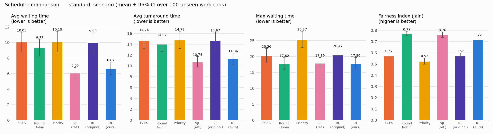
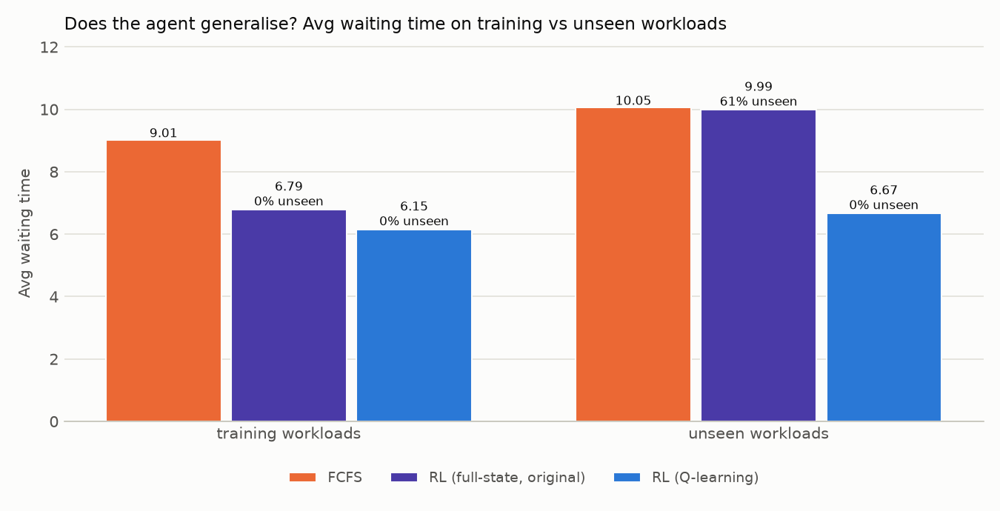

# Adaptive CPU Scheduling using Reinforcement Learning

A CPU-scheduling simulator plus a Q-learning agent that **learns** which process to run next,
benchmarked against FCFS, Round Robin and Priority scheduling on identical workloads.

*Team 5, Dept. of CSE (AI & ML), Mangalore Institute of Technology & Engineering:
Akansha Queen Dsouza, Diksha B R, Hegde Aishwarya Uday, Sayed Mohammed Sayan.*

## Run everything with one click

**Double-click `run_everything.bat`** (Windows), or run:

```powershell
python verify_all.py
```

It checks the environment, runs all **401 tests** with coverage, trains and evaluates the agent,
plants **28 bugs** to prove the tests catch them, and opens **`results/dashboard.html`**, a single
offline page with every number, chart and bug. The first run creates the virtual environment
automatically. It takes about 3 minutes (`python verify_all.py --fast` skips mutation testing: about 1 minute).

## Headline results (100 unseen workloads, standard scenario)

| Scheduler | Avg waiting | Avg turnaround | Max waiting | Fairness (Jain) |
|---|---|---|---|---|
| FCFS | 10.05 | 14.74 | 20.26 | 0.57 |
| Round Robin (q = 3) | 9.33 | 14.02 | 17.82 | 0.77 |
| Priority | 10.10 | 14.79 | 25.37 | 0.53 |
| **RL (Q-learning)** | **6.67** | **11.36** | **17.86** | 0.72 |
| SJF (reference, needs burst times in advance) | 6.05 | 10.74 | 17.89 | 0.76 |

* RL cuts average waiting time by **34 % vs FCFS, 29 % vs Round Robin and 34 % vs Priority**.
* It is **significantly better than all three in all 6 workload scenarios** (18/18 comparisons,
  paired permutation test, Holm-corrected p < 0.05), so **hypothesis H1 of the report is supported**.
  The gains range from 20 % to 43 %.
* It comes within 8-11 % of SJF (21 % on 20-process workloads), which needs to know every burst time in advance.
* Quality: **401 tests · 95 % coverage · 28/28 mutation score · 16 bugs found and fixed**
  ([`TESTING.md`](TESTING.md)).



## Step-by-step commands (Windows PowerShell)

```powershell
cd cpu-scheduler-rl-main
python -m venv venv                # once
venv\Scripts\Activate.ps1          # if blocked: Set-ExecutionPolicy -Scope CurrentUser RemoteSigned
pip install -r requirements.txt    # once

python test.py                     # 1. libraries installed?
python -m pytest                   # 2. all 401 tests (~45 s)
python main.py                     # 3. train + evaluate + charts (~10 s) -> results/
python main.py demo                # 4. every scheduler on the report's sample workload
python main.py demo --workload examples/convoy_effect.csv   # ...or on your own CSV of processes
python mutation_test.py            # 5. plant 28 bugs, prove the tests catch them (~2 min)
python mutation_test.py --show 1   #    plant one bug live and see exactly which tests catch it
```

On Linux/macOS use `source venv/bin/activate`.

**No need to activate at all:** you can call the venv's Python directly, which avoids the PowerShell
"running scripts is disabled" error. For example: `.\venv\Scripts\python main.py demo`.

**Sharing the project:** never copy or zip the `venv` folder. It only works on the computer that
created it. On a new computer, `run_everything.bat` builds a fresh one automatically.

| Command | What it does |
|---|---|
| `python main.py` | Train 3000 episodes, then evaluate 6 schedulers × 6 scenarios × 100 unseen workloads, writing CSV + PNG + `results/RESULTS.md` |
| `python main.py --quick` | Same, with small numbers |
| `python main.py train` / `evaluate` | Only train (saves `results/q_table.json`) / only evaluate the saved agent |
| `python main.py demo [--workload FILE.csv]` | Timelines, metrics and a ranking for one workload, plus `results/gantt_demo.png` |
| `--seed N --episodes N --workloads N --out DIR --no-plots` | Options (`--episodes 1000` reproduces the report's Appendix B) |
| `python simulator.py`, `fcfs.py`, `q_learning.py`, … | Each module also runs a small demo on its own |

Your own workload is a CSV with columns `id, arrival, burst, priority`; priority is optional,
and 1 is the highest priority. See [`examples/`](examples/).

## How it works

```
workload_generator.py ──> simulator.py ──> gym_env.py ──> q_learning.py
  synthetic or CSV         CPU, ready queue,   Gymnasium env:      Q-table agent,
  processes (Poisson       waiting/turnaround, state, action mask, epsilon-greedy,
  arrivals, exp/uniform/   context switches,   multi-objective     alpha=0.1, gamma=0.95
  bimodal bursts)          Gantt timeline      reward
        │                       │
        │        fcfs.py, round_robin.py, priority.py, sjf.py (baselines)
        ▼                       ▼
                 evaluate.py ──> visualize.py ──> results/*.csv, *.png, RESULTS.md, dashboard.html
          held-out workloads,    learning curve, comparisons,
          6 scenarios, CI95,     distributions, Gantt chart
          permutation tests
```

**MDP (report §4.5).**
* *State:* for each process in the ready queue (up to 20), the normalised remaining burst, waiting time and priority.
* *Action:* the index of the process to run, restricted by an action mask to real processes.
* *Reward:* the weighted sum of −average waiting added, −turnaround added, −context-switch penalty,
  +Jain fairness of the queue, and −starvation penalty. With only the waiting term on, the episode
  reward equals exactly −(average waiting time); a unit test checks this.

**Two tabular agents** (both in `q_learning.py`):
* `QLearningAgent`, the original design: the whole binned state is the Q-table key. It works on its
  10 training workloads, but **61 % of states on new workloads were never seen**, so it falls back to FCFS.
* `ProcessQLearningAgent`, the default: Q(s, a) is looked up by the *chosen process's* binned
  (burst, waiting, priority) plus queue length. Any similar process in any workload shares the same
  entry, so it generalises with a table of ≤ 576 entries. It is trained on workloads of 4-20 processes for
  3000 episodes; the tuning experiments are in `TESTING.md` §4.



## Project layout

| File | Purpose |
|---|---|
| `workload_generator.py` | Synthetic workloads, CSV loader, the report's Appendix-A workload |
| `simulator.py` | CPU scheduling simulator, metrics, input validation |
| `fcfs.py`, `round_robin.py`, `priority.py`, `sjf.py` | Classical schedulers (SJF = reference) |
| `gym_env.py` | Gymnasium environment (state, action mask, reward) |
| `q_learning.py` | Q-learning agents, training loop, save/load |
| `evaluate.py` | Evaluation module: scenarios, statistics, hypothesis test |
| `visualize.py` | Visualisation module: PNG charts |
| `main.py` | Command-line entry point |
| `verify_all.py`, `run_everything.bat` | One-command verification + HTML dashboard |
| `tests/` | 401 automated tests (unit, golden, property-based, robustness, performance, end-to-end) |
| `mutation_test.py` | Mutation testing (28 planted bugs) |
| `examples/` | Sample CSV workloads for the demo |
| `TESTING.md` | Bug report, test strategy, hand calculations, tuning log, limitations |
| `PRESENTATION.md` | Demo script and likely judge questions for the testathon |
| `results/` | Generated outputs (recreate with `python main.py` or `python verify_all.py`) |
| `.github/workflows/tests.yml` | CI: tests on Ubuntu + Windows, Python 3.10-3.13, plus mutation testing |
