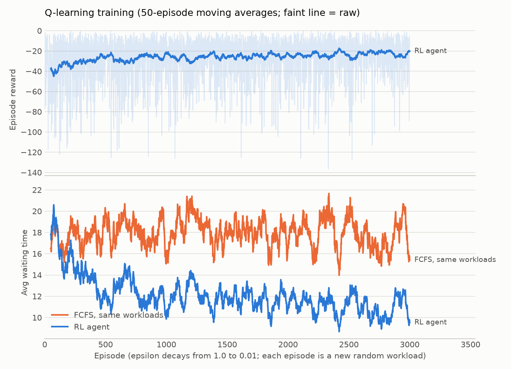
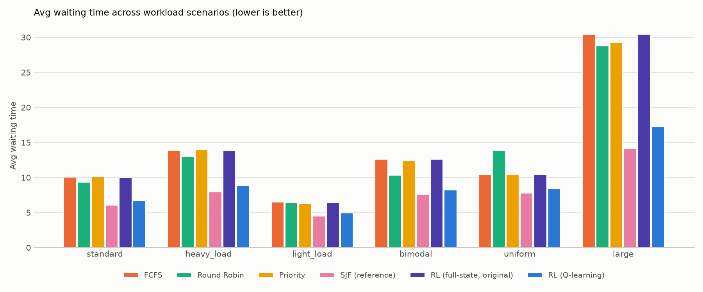
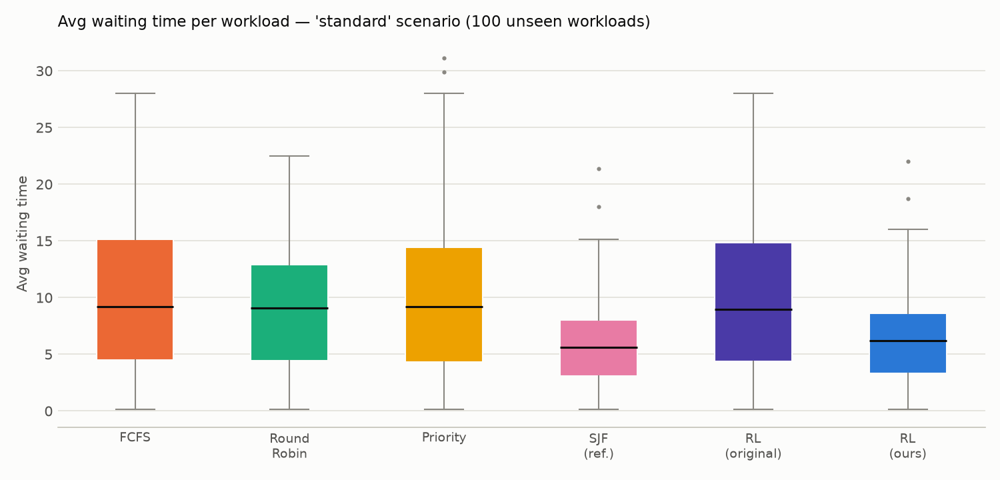
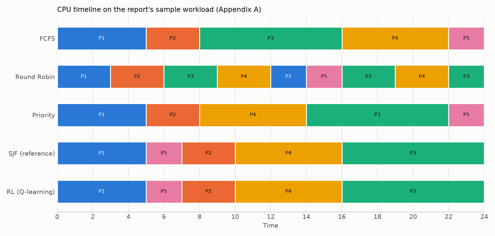

# Results

Generated by `python main.py` — seed 0, 3000 training episodes, 100 unseen test workloads per scenario (workload seeds >= 1000000, never used in training).

Hyperparameters: alpha=0.1, gamma=0.95, epsilon 1.0 -> 0.01 (x0.995/episode), Round Robin quantum=3.

Training: mean reward of first 150 episodes -37.40 -> last 150 episodes -23.84.

## Hypothesis (report section 4.9.1)

**H1 supported — H0 rejected**: in the standard scenario the RL scheduler is significantly better (paired permutation test, Holm-corrected p < 0.05) than all of FCFS, Round Robin and Priority on: avg_waiting_time, avg_turnaround_time.

## Scenario `standard` — Training distribution: 8 processes, mean gap 2, exponential bursts (mean 5)

| Scheduler | avg_waiting_time | avg_turnaround_time | avg_response_time | max_waiting_time | context_switches | fairness_index |
|---|---|---|---|---|---|---|
| FCFS | 10.05 ± 1.26 | 14.74 ± 1.52 | 10.05 ± 1.26 | 20.26 ± 2.27 | 7.00 ± 0.00 | 0.57 ± 0.03 |
| Round Robin | 9.33 ± 1.09 | 14.02 ± 1.34 | 4.02 ± 0.39 | 17.82 ± 1.84 | 13.51 ± 0.74 | 0.77 ± 0.02 |
| Priority | 10.10 ± 1.33 | 14.79 ± 1.58 | 10.10 ± 1.33 | 25.37 ± 2.54 | 7.00 ± 0.00 | 0.53 ± 0.03 |
| SJF (reference) | 6.05 ± 0.75 | 10.74 ± 0.98 | 6.05 ± 0.75 | 17.89 ± 1.81 | 7.00 ± 0.00 | 0.76 ± 0.02 |
| RL (Q-learning) | 6.67 ± 0.80 | 11.36 ± 1.05 | 6.67 ± 0.80 | 17.86 ± 1.84 | 7.00 ± 0.00 | 0.72 ± 0.02 |
| RL (full-state, original) | 9.99 ± 1.26 | 14.67 ± 1.52 | 9.99 ± 1.26 | 20.47 ± 2.25 | 7.00 ± 0.00 | 0.57 ± 0.03 |

RL improvement in avg waiting time (positive = RL better, Holm-corrected p): FCFS +33.7% (p=0.018); Round Robin +28.5% (p=0.018); Priority +34.0% (p=0.018); SJF (reference) -10.2% (p=0.018); RL (full-state, original) +33.2% (p=0.018)

## Scenario `heavy_load` — Arrivals twice as dense -> longer queues

| Scheduler | avg_waiting_time | avg_turnaround_time | avg_response_time | max_waiting_time | context_switches | fairness_index |
|---|---|---|---|---|---|---|
| FCFS | 13.89 ± 1.70 | 18.85 ± 2.03 | 13.89 ± 1.70 | 27.45 ± 2.86 | 7.00 ± 0.00 | 0.55 ± 0.03 |
| Round Robin | 12.98 ± 1.53 | 17.94 ± 1.86 | 5.65 ± 0.34 | 22.91 ± 2.21 | 14.22 ± 0.90 | 0.76 ± 0.02 |
| Priority | 13.95 ± 1.58 | 18.90 ± 1.91 | 13.95 ± 1.58 | 30.16 ± 2.72 | 7.00 ± 0.00 | 0.53 ± 0.03 |
| SJF (reference) | 7.94 ± 1.11 | 12.89 ± 1.43 | 7.94 ± 1.11 | 23.05 ± 2.32 | 7.00 ± 0.00 | 0.82 ± 0.02 |
| RL (Q-learning) | 8.83 ± 1.22 | 13.78 ± 1.55 | 8.83 ± 1.22 | 24.23 ± 2.52 | 7.00 ± 0.00 | 0.77 ± 0.02 |
| RL (full-state, original) | 13.85 ± 1.71 | 18.80 ± 2.04 | 13.85 ± 1.71 | 27.76 ± 2.83 | 7.00 ± 0.00 | 0.54 ± 0.03 |

RL improvement in avg waiting time (positive = RL better, Holm-corrected p): FCFS +36.4% (p=0.018); Round Robin +32.0% (p=0.018); Priority +36.7% (p=0.018); SJF (reference) -11.2% (p=0.018); RL (full-state, original) +36.2% (p=0.018)

## Scenario `light_load` — Sparse arrivals -> short queues, little choice

| Scheduler | avg_waiting_time | avg_turnaround_time | avg_response_time | max_waiting_time | context_switches | fairness_index |
|---|---|---|---|---|---|---|
| FCFS | 6.49 ± 1.14 | 11.57 ± 1.43 | 6.49 ± 1.14 | 14.36 ± 2.04 | 7.00 ± 0.00 | 0.60 ± 0.03 |
| Round Robin | 6.39 ± 1.26 | 11.46 ± 1.55 | 2.25 ± 0.35 | 13.86 ± 2.17 | 13.53 ± 0.87 | 0.82 ± 0.02 |
| Priority | 6.29 ± 1.15 | 11.36 ± 1.43 | 6.29 ± 1.15 | 18.63 ± 2.66 | 7.00 ± 0.00 | 0.57 ± 0.04 |
| SJF (reference) | 4.49 ± 0.74 | 9.56 ± 1.04 | 4.49 ± 0.74 | 14.23 ± 2.07 | 7.00 ± 0.00 | 0.70 ± 0.03 |
| RL (Q-learning) | 4.94 ± 0.80 | 10.02 ± 1.10 | 4.94 ± 0.80 | 13.56 ± 2.03 | 7.00 ± 0.00 | 0.69 ± 0.03 |
| RL (full-state, original) | 6.44 ± 1.14 | 11.51 ± 1.43 | 6.44 ± 1.14 | 14.71 ± 2.02 | 7.00 ± 0.00 | 0.60 ± 0.03 |

RL improvement in avg waiting time (positive = RL better, Holm-corrected p): FCFS +23.9% (p=0.018); Round Robin +22.7% (p=0.018); Priority +21.4% (p=0.018); SJF (reference) -10.1% (p=0.018); RL (full-state, original) +23.3% (p=0.018)

## Scenario `bimodal` — 80% short interactive + 20% long CPU-bound jobs

| Scheduler | avg_waiting_time | avg_turnaround_time | avg_response_time | max_waiting_time | context_switches | fairness_index |
|---|---|---|---|---|---|---|
| FCFS | 12.62 ± 1.65 | 17.91 ± 1.99 | 12.62 ± 1.65 | 25.22 ± 2.80 | 7.00 ± 0.00 | 0.56 ± 0.03 |
| Round Robin | 10.34 ± 1.52 | 15.63 ± 1.88 | 3.68 ± 0.39 | 20.99 ± 2.62 | 15.18 ± 1.07 | 0.77 ± 0.02 |
| Priority | 12.39 ± 1.61 | 17.68 ± 1.95 | 12.39 ± 1.61 | 29.06 ± 3.05 | 7.00 ± 0.00 | 0.51 ± 0.03 |
| SJF (reference) | 7.60 ± 1.00 | 12.89 ± 1.33 | 7.60 ± 1.00 | 21.40 ± 2.42 | 7.00 ± 0.00 | 0.72 ± 0.03 |
| RL (Q-learning) | 8.22 ± 1.07 | 13.51 ± 1.41 | 8.22 ± 1.07 | 21.49 ± 2.44 | 7.00 ± 0.00 | 0.69 ± 0.03 |
| RL (full-state, original) | 12.62 ± 1.65 | 17.91 ± 2.00 | 12.62 ± 1.65 | 25.54 ± 2.80 | 7.00 ± 0.00 | 0.54 ± 0.03 |

RL improvement in avg waiting time (positive = RL better, Holm-corrected p): FCFS +34.9% (p=0.018); Round Robin +20.5% (p=0.018); Priority +33.7% (p=0.018); SJF (reference) -8.1% (p=0.018); RL (full-state, original) +34.9% (p=0.018)

## Scenario `uniform` — Uniform bursts in [1, 9]

| Scheduler | avg_waiting_time | avg_turnaround_time | avg_response_time | max_waiting_time | context_switches | fairness_index |
|---|---|---|---|---|---|---|
| FCFS | 10.40 ± 0.76 | 15.28 ± 0.88 | 10.40 ± 0.76 | 20.50 ± 1.36 | 7.00 ± 0.00 | 0.67 ± 0.03 |
| Round Robin | 13.83 ± 1.16 | 18.70 ± 1.29 | 5.69 ± 0.35 | 22.31 ± 1.38 | 14.35 ± 0.45 | 0.86 ± 0.01 |
| Priority | 10.41 ± 0.75 | 15.28 ± 0.88 | 10.41 ± 0.75 | 26.33 ± 1.64 | 7.00 ± 0.00 | 0.59 ± 0.03 |
| SJF (reference) | 7.76 ± 0.58 | 12.63 ± 0.70 | 7.76 ± 0.58 | 22.64 ± 1.56 | 7.00 ± 0.00 | 0.83 ± 0.01 |
| RL (Q-learning) | 8.37 ± 0.63 | 13.24 ± 0.76 | 8.37 ± 0.63 | 21.52 ± 1.51 | 7.00 ± 0.00 | 0.80 ± 0.01 |
| RL (full-state, original) | 10.45 ± 0.76 | 15.32 ± 0.88 | 10.45 ± 0.76 | 21.22 ± 1.33 | 7.00 ± 0.00 | 0.66 ± 0.03 |

RL improvement in avg waiting time (positive = RL better, Holm-corrected p): FCFS +19.6% (p=0.018); Round Robin +39.5% (p=0.018); Priority +19.6% (p=0.018); SJF (reference) -7.8% (p=0.018); RL (full-state, original) +19.9% (p=0.018)

## Scenario `large` — 20 processes per workload (agent was trained on 8)

| Scheduler | avg_waiting_time | avg_turnaround_time | avg_response_time | max_waiting_time | context_switches | fairness_index |
|---|---|---|---|---|---|---|
| FCFS | 30.42 ± 2.42 | 35.45 ± 2.60 | 30.42 ± 2.42 | 59.29 ± 4.19 | 19.00 ± 0.00 | 0.49 ± 0.02 |
| Round Robin | 28.76 ± 2.38 | 33.78 ± 2.56 | 12.85 ± 0.77 | 65.96 ± 4.35 | 39.12 ± 1.43 | 0.69 ± 0.01 |
| Priority | 29.27 ± 2.40 | 34.29 ± 2.58 | 29.27 ± 2.40 | 77.89 ± 4.32 | 19.00 ± 0.00 | 0.42 ± 0.02 |
| SJF (reference) | 14.19 ± 1.22 | 19.21 ± 1.40 | 14.19 ± 1.22 | 65.56 ± 4.24 | 19.00 ± 0.00 | 0.74 ± 0.01 |
| RL (Q-learning) | 17.22 ± 1.62 | 22.24 ± 1.80 | 17.22 ± 1.62 | 64.97 ± 4.42 | 19.00 ± 0.00 | 0.64 ± 0.01 |
| RL (full-state, original) | 30.42 ± 2.42 | 35.44 ± 2.60 | 30.42 ± 2.42 | 59.56 ± 4.17 | 19.00 ± 0.00 | 0.49 ± 0.02 |

RL improvement in avg waiting time (positive = RL better, Holm-corrected p): FCFS +43.4% (p=0.018); Round Robin +40.1% (p=0.018); Priority +41.2% (p=0.018); SJF (reference) -21.4% (p=0.018); RL (full-state, original) +43.4% (p=0.018)

## Generalisation check

| Workload set | Scheduler | Avg waiting time | Unseen-state rate |
|---|---|---|---|
| training workloads | FCFS | 9.01 | — |
| training workloads | RL (Q-learning) | 6.15 | 0% |
| training workloads | RL (full-state, original) | 6.79 | 0% |
| unseen workloads | FCFS | 10.05 | — |
| unseen workloads | RL (Q-learning) | 6.67 | 0% |
| unseen workloads | RL (full-state, original) | 9.99 | 61% |

## Charts

